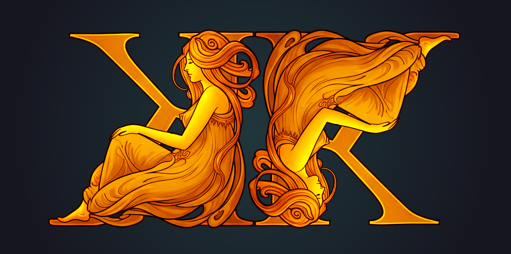
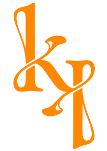

#  KouraiKhryseai

[](https://search.maven.org/artifact/io.github.josemg08/kouraikhryseai)
[](https://github.com/josemg08/KouraiKhryseai/blob/master/LICENSE)
[](https://android-arsenal.com/api?level=24)

> "These are golden, and in appearance like living young women. There is intelligence in their hearts, and there is speech in them and strength..." - Homer, Iliad 18.417-420

##  Overview

KouraiKhryseai (from Ancient Greek: κοῦραι χρύσειαι, "golden maidens") is an elegant Android theme wrapper library inspired by Hephaestus's legendary automata. Just as these divine constructs assisted the god craftsman in his forge, this library aims to empower Android developers in crafting beautiful and accessible applications.

##  Features

* **Material Design 3 Compatible** - Seamless integration with the latest Material Design guidelines
* **Golden Ratio** - Dimension follow Fibonacci sequence to achieve natural symmetry
* **Performance Optimized** - Lightweight implementation with minimal overhead
* **Ease of use** - Highly customizable with minimal tinkering

##  Installation

Add the dependency to your `build.gradle` or `build.gradle.kts`:

```groovy
implementation 'io.github.josemg08:kouraikhryseai:1.0.3'
```

```kotlin
implementation("io.github.josemg08:kouraikhryseai:1.0.3")
```

Or in Version Catalog (`gradle/libs.versions.toml`):

```toml
[versions]
kouraikhryseai = "1.0.3"

[libraries]
kouraikhryseai = { group = "io.github.josemg08", name = "kouraikhryseai", version.ref = "kouraikhryseai" }
```

```kotlin
implementation(libs.kouraikhryseai)
```

> **Requires Kotlin 2.1.0+** and Compose.

### Version Compatibility

| Version | Kotlin | Notes |
|---------|--------|-------|
| `1.0.3` | 2.1.0 | Binary-compatible with Kotlin 2.1.0+ consumers |
| `1.0.2` | 2.4.10 | Requires Kotlin 2.4.0+ to consume (metadata version 2.4.0) |
| `1.0.1` | 2.4.10 | Requires Kotlin 2.4.0+ to consume |

If your project uses Kotlin 2.1.0–2.3.x, use **1.0.3**. If your project uses Kotlin 2.4.0+, you can use either version.

##  Usage

### Quick Start

Wrap your content in `KTheme` and access tokens through `KTokens` — no initialization required:

```kotlin
class MainActivity : ComponentActivity() {
    override fun onCreate(savedInstanceState: Bundle?) {
        super.onCreate(savedInstanceState)
        setContent {
            KTheme {
                // Material 3 colors
                KTokens.materialColors.primary
                KTokens.materialColors.surface

                // Extended semantic colors (success, warning, info, brand)
                KTokens.extendedColors.success
                KTokens.extendedColors.warning

                // Adaptable dimensions (scales automatically based on screen width)
                KTokens.dimensions.spacing.spacing16
                KTokens.dimensions.goldenRatio.goldenRatio21
                KTokens.dimensions.plasticSize.plastic86

                // Typography & shapes
                KTokens.typography
                KTokens.shapes.card
            }
        }
    }
}
```

### Theme Configuration

KouraiKhryseai provides a flexible theming system through `KThemeConfig` and `KTheme`. The configuration above works with defaults — the steps below are **optional** and only needed if you want custom colors or fonts.

#### Basic Setup

```kotlin
class MyApplication : Application() {
    override fun onCreate() {
        super.onCreate()
        KThemeConfigHolder.init(
            config = KThemeConfig()
        )
    }
}
```

#### Providing your own basic colors

```kotlin
KThemeConfigHolder.init(
    config = KThemeConfig(
        colors = KColorConfig(
            primary = Color(0xFF6750A4),
            secondary = Color(0xFF625B71),
            tertiary = Color(0xFF7D5260)
        )
    )
)
```

#### Providing complete Material 3 ColorScheme

```kotlin
KThemeConfigHolder.init(
    config = KThemeConfig(
        colors = KColorConfig(
            lightColorsScheme = ColorScheme(
                primary = Color(0xFF6750A4),
                onPrimary = Color(0xFFFFFFFF),
                // ... other colors
            ),
            darkColorsScheme = ColorScheme(
                primary = Color(0xFFD0BCFF),
                onPrimary = Color(0xFF381E72),
                // ... other colors
            )
        )
    )
)
```

#### Providing your own font
this font will be automatically added to the configuration so it uses the correct dimens for scalling acoording to SW.

```kotlin
val yourFontFamily =
            ResourcesCompat.getFont(this, R.font.yourFont)?.let {
                FontFamily(it)
            } ?: FontFamily.Default

        KThemeConfigHolder.init(
            config = KThemeConfig(
                fontFamily = yourFontFamily
            )
        )
```

##  Mythological Inspiration

In Homer's Iliad, Hephaestus - the god of craftsmanship, fire, and metallurgy - created golden handmaidens endowed with intelligence, speech, and divine knowledge. These remarkable automata served as his assistants in the divine forge, representing the perfect union of artistry and functionality.

Like these mythical helpers, KouraiKhryseai aims to be your reliable companion in Android development, providing intelligent solutions and robust building blocks for creating exceptional user experiences.
